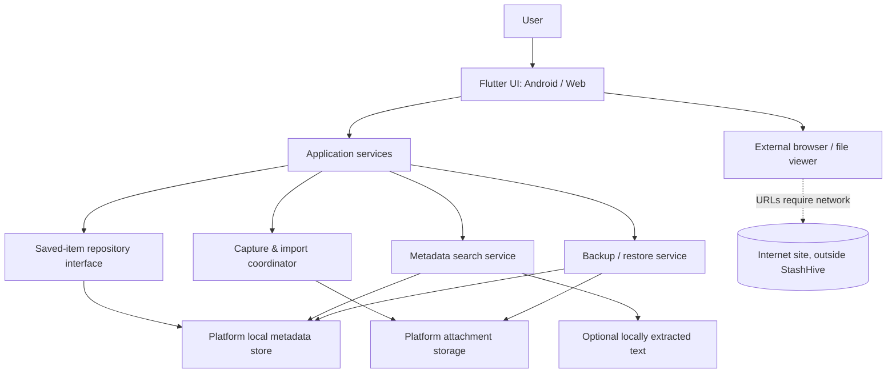

# StashHive — Architecture and Platform Assumptions

**Status:** Working architecture for the approved MVP. Implementation uses the boundaries described below; storage selection, browser persistence, Android file/share behavior and performance assumptions remain provisional until the planned proof-of-concept and manual validation evidence is collected.  
**Date checked for technical references:** 2026-10-21

## Recommendation in plain language

Use one Flutter codebase for the proposed Android-first app and a companion web app, with a small domain layer and platform-specific storage/import adapters. Keep the core local-first: no account server, hosted database, or paid AI API. Store metadata locally and keep imported attachments under a managed local storage strategy. Add a versioned export/restore path before release.

Flutter's official web documentation describes browser support for app-style experiences; its FAQ also explains that the browser does not expose the native file system through `dart:io`, so platform I/O must be separated. See `docs/research/official-sources.md`.

## Context diagram

## Logical components

- **Presentation:** library, search, save/edit, item detail, collections, backup/privacy settings; accessible responsive components.
- **Application/domain:** `SavedItem`, `Tag`, `Collection`, item validation, filter/search behavior, duplicate review, and delete semantics. No Flutter file-system calls inside domain logic.
- **Repository interface:** CRUD, queries, sorting, tags/collections, transaction boundaries, and migration version.
- **Metadata persistence adapter:** a local store selected after Android + web proof of concept. `hive_ce` is the leading candidate because its package documentation says browser boxes use IndexedDB and other platforms use files; its indexing/search suitability must be measured. Isar Community and SQLite alternatives are noted below.
- **Attachment storage adapter:** Android app-specific private directory for app-managed copies; web browser storage/IndexedDB or a user-selected file reference according to validated behavior. Do not store temporary cache data as the only copy of an attachment. Explain uninstall/browser-clear consequences.
- **Capture/import adapter:** manual form, Android system share target, file picker, and web file selection. Android share support must be based on documented intent MIME types and tested against real source apps.
- **Search service:** first search locally stored metadata. Add an extracted-text field/index only for file types/languages whose extraction is validated and available offline. Avoid remote search services.
- **Backup/restore service:** versioned manifest + metadata + copied attachments; validate archive paths, sizes, schema version, file hashes, and conflicts before committing imported state. Export via user-selected destination/download.
- **External links:** open in system browser. Optional title/favicons/page metadata may be fetched only after a later scope decision, using clear UI and safe network boundaries.

### Optional link health checks

Link status is a user-triggered, direct request from the native device, not an online service or background crawler. The native checker validates the HTTP(S) URL, resolves and blocks local/private/reserved addresses, pins the socket to the validated DNS result to reduce DNS-rebinding exposure, uses a bounded timeout, forces a direct connection, does not follow redirects, and uses response headers/status only. HEAD is the only request method; sites that reject it are reported as unsupported rather than fetched with GET. The browser implementation explains its cross-origin limitation rather than proxying requests. Status/time are bounded local preference metadata, not part of the saved-item record or version-1 backup; checking must not update the saved item's content or timestamp.

## Data model (draft)

### SavedItem

| Field | Type / rule | Notes |
|---|---|---|
| `id` | Stable opaque ID | Never use URL or title as primary key. |
| `type` | link / image / text / document | Video/social URLs remain `link` with a source subtype until true media importing is implemented. |
| `title` | Optional user-editable string | Searchable; generated fallback should be clearly editable. |
| `url` | Optional normalized URL | Only for a link/source URL; validate schemes. |
| `text` | Optional note/snippet | User-provided text; local search source. |
| `attachmentKey` | Optional storage key | Not an absolute machine-specific path. |
| `mimeType`, `byteSize` | Optional metadata | For supported attachments; validate MIME and size. |
| `sourceKind` | manual / share / file-picker | Helps explain where item came from; do not over-collect. |
| `savedAt`, `updatedAt` | UTC instants stored consistently | Render using local locale/time zone. |
| `tags` | List of tag IDs | Prefer normalized tags if relation semantics grow. |
| `collectionId` | Optional stable ID | At most one collection for MVP unless user need changes. |
| `isFavorite` | Boolean | Default false. |
| `extractedText` | Optional derived text | Only after local extractor succeeds; can be cleared/rebuilt. |
| `extractionStatus` | notRequested / available / unsupported / failed | Never treat failure as empty successful extraction. |
| `contentHash` | Optional checksum | For integrity/duplicate suggestion, not tracking. |
| `annotations` | Up to 50 `SavedAnnotation` records per item | User-entered quote and/or note, stable ID and timestamp; size-limited, searchable, local-only. Older records default to an empty list. |
| `schemaVersion` | Backup-level initially | Plan DB migration separately if needed. |

### Tag and Collection

`Tag`: stable ID, name, normalized search key, created/updated times. Avoid duplicate tag names under documented case/Unicode rules. `Collection`: stable ID, name, optional description/emoji, created/updated times. Deleting a collection must leave its items in the library and clear their collection assignment after confirmation.

## Capture and storage flows

### Save a link

1. User pastes a URL or shares it from another app.
2. Validate scheme, preserve the original URL for display, optionally normalize only for duplicate checking.
3. Ask the user to confirm/edit title, notes, tags, and collection as applicable.
4. Store local metadata; no webpage is downloaded by default.
5. If the user later opens it, launch the external browser. Network errors belong to the external browser or are explained clearly.
6. Users may manually paste a quote/excerpt and personal note into the item's Highlights & Annotations section, or explicitly open the temporary reader, select a passage and tap Save highlight. Only the user-selected quote plus bounded surrounding context/offsets are stored locally; fetched page text and HTML remain transient and are not included in backups. StashHive does not scrape pages automatically or imply that the linked article is readable offline.

### Save an image/document

1. User selects a file or shares it to the app.
2. Validate supported type and size; copy bytes into managed storage when the feature is designed to own the copy.
3. Write metadata and attachment reference as one recoverable operation; clean orphaned temp files on failure.
4. Create a thumbnail only if useful and feasible; treat thumbnail as a cache, never the sole original.
5. Add a backup/export representation and validate restoration.

### Web platform

- All browser data belongs to the current origin/browser profile. Do not imply cross-device sync.
- No unrestricted local file system access; user selection/download flows must use browser capabilities.
- Browser quota and site-data clearing may remove records/attachments. Prominent export/restore and a first-run reminder are required.
- Opening external URLs is online activity; do not fetch page content invisibly in the background.

## Technology candidates — pending proof of concept

| Area | Candidate | Reason | Validation needed |
|---|---|---|---|
| UI/domain | Flutter + Dart | Fits user's existing Flutter projects; supports app-style web deployment. | Reconfirm local SDK and test Android/web build after approval. |
| Metadata store | `hive_ce` candidate | Package docs describe browser IndexedDB persistence and file-backed boxes on other platforms. | CRUD/migrations, structured filtering, 10k-item search, schema evolution, backup export, package health/version. |
| Alternative store | `isar_community` | Potential indexed local queries. | Current package platform declaration and web behavior must be verified before selection. |
| Alternative store | `sqflite` / SQLite | Mature SQL on mobile, but official package page describes Android/iOS/macOS, with web support listed as experimental through a different package. | May force separate web persistence adapter, raising complexity. |
| Attachment selection | Platform picker/share integrations | User-mediated file selection is privacy-friendly. | Android intent intake + Flutter plugin support; browser file selection and persistence. |
| OCR/text extraction | Not selected | Offline processing is preferred, but model size/language quality is a risk. | POC must record accuracy, languages, offline behavior, app size, latency, and memory. |
| Web hosting | Static hosting such as Cloudflare Pages | Avoids an app backend for a Flutter web build. | Verify current build command, output folder, cache/update behavior, and free-plan limits before deploy. |

## Security / privacy boundaries

- All saved content is untrusted input: URLs, file names, MIME types, archive paths, extracted text, and imported manifests.
- Reject unsupported URL schemes; do not auto-open arbitrary commands or local paths.
- On restore, prevent path traversal, oversized files/archives, duplicate IDs, invalid schema versions, and archive bombs; import into staging before changing the current library.
- Do not log titles, user notes, URLs, document names, image OCR, or imported content.
- Never request broad file-storage access if user-mediated picking and app-managed copies satisfy the feature.
- No network transmission of the library in the MVP. Any future sync, analytics, ads, or remote extraction needs a separate threat/privacy review and explicit product decision.

## Key trade-offs

- **Local-first vs sync:** zero ongoing backend cost and strong privacy, but no automatic cross-device sync. User-controlled backup is the bridge.
- **Metadata search vs OCR:** reliable and small initial core vs more findability. OCR waits until accuracy and binary size are evidenced.
- **One Flutter UI vs platform parity:** shared screens/domain code; platform-specific storage/import behavior still needs separate tests.
- **Browser persistence vs managed files:** web can offer useful local saving but cannot promise durable native-file access; backup messaging is critical.

## Architecture status

- `DONE`: proposed component boundaries, main entity model, important trade-offs, privacy boundaries, and initial Flutter/repository/backup/share source implementation.
- `IN PROGRESS`: validation of Hive CE on Android/web; Android share API behavior on device; browser persistence/backup behavior; backup recovery/checksum regressions; dependency and license review.
- `BLOCKED / DEFERRED`: OCR feasibility and text-extraction implementation until a separate offline feasibility study is approved.
- `NOT STARTED`: final release/deployment decisions, opt-in user testing, and store-readiness checks.

## Phase 1 implementation update — 2026-10-21

Implemented source currently uses three Hive CE boxes: saved item records, attachment bytes, and settings/collection metadata. All UI accesses storage through `LibraryRepository`. Browser/Android behavior is not yet validated by a local SDK run; use CI and real platform tests before locking this choice. Backup format v1 is JSON with a manifest, version, items, collections and base64 attachment entries; the application limits each attachment to 15 MB and combined backup attachments to 100 MB.

## Phase 1 implementation status — 2026-10-21

The first code slice uses three Hive CE boxes via `LibraryRepository`: saved-item records, attachment bytes, and preferences/collections. UI widgets depend on the repository rather than opening boxes directly. This is a provisional persistence choice; Flutter CI and Android/web manual tests must pass before it is considered validated. Backup version 1 is JSON with items, collections, versioned manifest metadata and base64 attachments, capped at 15 MB per attachment and 100 MB combined attachment bytes.

## Phase 2 implementation note — share-event fingerprinting (2026-10-22)

The incoming-share deduplicator serializes each ordered batch's type, path and MIME type, then uses the SHA-256 digest as its short-lived cache key. The cache is bounded by entry count and stores digest strings rather than shared text or paths. The direct dependency is `crypto: ^3.0.7`; package resolution and browser/Android build compatibility remain unverified until the owner requests the manual validation run.

## Phase 2/3 implementation status — 2026-10-22

Core source now includes sequential incoming-share review, bounded/collision-resistant share-event fingerprints, backup/restore validation and rollback coverage, per-attachment SHA-256 integrity checks, text-scale-aware card sizing, theme-aware muted-text contrast, and accessible search/favorite/action semantics. These are source-level changes with regression tests authored; no claim is made that the tests, web/Android builds, Android chooser behavior, browser restart persistence, or screen-reader checks have passed. The manual validation workflow remains disabled for automatic push triggers by owner request.

## Save/backup validation alignment — 2026-10-22

`BackupCodec.validateSavedItem` is the shared item-level validation boundary used before repository writes and during backup encode/decode. The saved URL maximum is defined alongside the saved-item model and reused by incoming-share intake, Quick Save and backup validation. This keeps invalid item kinds, malformed attachment metadata and over-limit fields from being intentionally saved or exported only to fail later during restore. Attachment byte writes and orphan cleanup still use best-effort rollback; process death and underlying storage failures require the manual platform validation plan.

## Backup v1 completeness metadata — 2026-10-22

The implemented JSON v1 backup format may include two optional non-negative counters: `omittedUnreadableRecordCount` for raw local records that could not be materialized, and `omittedCollectionEntryCount` for legacy collection entries/assignments normalized or omitted during collection recovery. Export includes the counters when non-zero; decode defaults either missing field to zero so existing v1 backups remain compatible. Restore confirmation must explain these counts, because a backup cannot reconstruct raw records or collection data that were omitted from its contents.

Before export, the repository blocks any remaining visible item assignment that cannot be represented within the portable 500-collection cap. Collection assignments are canonicalized against the merged collection list during restore. These changes are implemented in source with regression cases, but the tests and Android/web restore flows remain unverified until the manual validation checkpoint.

## Product identity and compatibility

The user-facing product brand is StashHive. Keep the existing `stashhive` Dart package identifier, Hive store keys (`stashhive_*_v1`) and version-1 JSON backup marker (`StashHive`) stable. Backups created under the former StashTrail product name must remain importable. Any future change to package, storage or backup identifiers requires an explicit migration and compatibility plan.

## Advanced Search and saved presets (SH-002)

- `lib/services/search_filters.dart` owns the immutable, serializable Search filter settings and the pure local filter/sort operation. It combines the existing text query with item type, normalized tag, collection, domain/subdomain, favorite state, saved-date range and sort order. It does not fetch webpages or modify saved URLs.
- The Search UI reads tags and collections from the current local repository snapshot. A saved preset captures the query and complete active filter/sort settings so it can be reused consistently. Organize → Collections exposes presets as Smart Searches; selecting one opens Search with the full preset applied.
- Saved preset metadata is stored in the existing `stashhive_preferences_v1` Hive box. Storage is local to the current Android app installation or browser origin/profile. The implementation caps the list at 20 presets, bounds names and filter fields, skips malformed entries, replaces names case-insensitively and attempts best-effort rollback when a preference write reports failure after commit.
- Saved search presets are preferences, not library items, and are not included in JSON backup v1. They do not sync between Android and web. This limitation is communicated in the UI when a preset is saved.
- Test targets: TC-247 filter combinations and bounds, TC-248 UI/save/reuse behavior, and TC-249 persistence/invalid-entry/rollback handling. All require the owner-requested manual validation checkpoint before they are considered verified.

## Smart tag rules (SH-008)

- `lib/services/smart_tag_rules.dart` owns bounded, user-authored matching rules. A rule contains a phrase and the tag to suggest; matching is case-insensitive over the current Quick Save title, URL and notes text only.
- Suggestions are computed locally and shown as chips in Quick Save. The user must select a chip to append a tag. Existing tags and duplicate suggested outputs are excluded; rules do not auto-apply, fetch pages, or invoke AI.
- Rules are stored in the existing `stashhive_preferences_v1` preferences box with a limit of 50, validation, malformed-record recovery and best-effort rollback for late write failures. They are local to the current Android installation or browser profile and are intentionally excluded from JSON backup v1.
- The Settings → Organization page creates and deletes rules. Reusing the same phrase/tag pair (case-insensitive) replaces that rule rather than creating a duplicate.
- Test targets: TC-258, `test/smart_tag_rules_test.dart`, `test/smart_tag_rules_widget_test.dart`, Quick Save widget tests and repository persistence/rollback tests. Source is committed; verification remains pending at the manual checkpoint.

### Reader response character encoding

The native article reader honors declared Windows-1252 (windows-1252 and cp1252) with an explicit mapping for its special 0x80–0x9F byte range. It keeps Latin-1/ISO-8859-1 separate and otherwise falls back to UTF-8 with malformed sequences replaced. Encoding regressions are source-authored and remain unverified until the manual validation checkpoint; this is not a promise of complete charset detection or full Readability support.

### Native Reader title extraction

The native Reader extracts the document title only after removing active embedded blocks and HTML comments from the source, then sanitizes the title to plain text and caps it at 300 characters. This avoids selecting a title-looking fragment embedded in a script string/comment; the regex-based implementation is still a lightweight fallback, not a standards-complete HTML parser. Regression source exists but remains unrun until the manual validation checkpoint.

### Native Reader bounded HTML charset prescan — 2026-10-29

Character decoding prefers the server's Content-Type charset. When an HTML response lacks that parameter, the native reader inspects at most the first 1,024 response bytes for a direct meta charset or the legacy http-equiv/content declaration. This is a targeted compatibility fallback; it does not implement the complete HTML encoding sniffing algorithm, and tests/platform behavior remain unverified until the manual checkpoint.

### Native Reader rejects embedded meta charset lookalikes — 2026-10-29

Before extracting a charset from the bounded HTML prefix, native parsing strips HTML comments and script/style/noscript blocks. This is a small defensive filter: apparent meta tags inside embedded content must not influence text decoding. TC-275 covers the behavior; tests and platform verification remain pending.

### Reader annotation Unicode boundaries — 2026-10-30

Reader selections and offsets use Dart/Flutter UTF-16 code-unit indexing. The shared \`captureArticleReaderSelection\` helper expands endpoints outward if they fall inside a surrogate pair and applies the same protection to the bounded surrounding context, so a saved excerpt never contains half of a supplementary character. The saved offsets continue to describe the normalized quote range. TC-280–TC-282 provide source regression coverage; execution and platform selection behavior remain unverified.

### Reader annotation re-anchoring — 2026-10-30

A saved annotation's old UTF-16 offsets are metadata for the extraction from which it was originally captured, not proof of its position in a later page version. \`findSavedAnnotationAnchor\` therefore ignores those offsets and searches the current temporary text for exact quote occurrences. It proposes a unique occurrence directly, or a repeated occurrence only when the stored before/after context yields a uniquely stronger contiguous match of at least 12 code units. Quotes shorter than 8 characters and oversized inputs are rejected; candidate output is capped at eight. Ambiguous/not-found results do not offer an update. Reader highlights a safe candidate for review, and only the explicit Update saved position action persists new offsets/context while retaining annotation identity, quote, note and creation time. Matching is exact-text only; there is no fuzzy matching and no fetched page body is stored.

### Re-anchoring legacy data and candidate bounds — 2026-10-30

The exact matcher rejects malformed UTF-16 in stored quote/context strings (including possible remnants from older selection boundaries), quotes shorter than eight code units, context over the model's 200-character cap, and article text over the Reader's 60,000-character cap. It reports the full occurrence count but exposes at most eight ranked candidate positions. The locate-quote route itself is read-only; only the user's separate Update saved position action writes new offset/context metadata.

### Re-anchor confirmation conflict guard — 2026-10-30

The Reader passes the expected quote alongside the annotation ID when requesting a position update. Before writing, Item Details reloads the current record and verifies that the annotation still exists, its quote is unchanged, and the proposed range length equals the current quote length and remains within the Reader offset cap. This prevents a stale Reader route from overwriting a newer annotation that reused the same ID. The Reader also displays a compact before/quote/after excerpt for review, while retaining the full-text highlight. TC-288 covers the stale-quote conflict; source remains unexecuted.

### Re-anchored annotations and portable backup/export — 2026-10-30

Re-anchoring changes only the selected annotation's offset and bounded context metadata; the fetched article remains transient. The existing versioned backup serializes the saved annotation fields, while CSV/Markdown exports contain only the user's saved quote and note, not fetched page paragraphs. TC-289 exercises the re-anchor → JSON backup decode → CSV/Markdown path and checks that the saved item's original title/content/URL remain unchanged. Test source exists but has not been executed.

### Re-anchor optimistic concurrency snapshot — 2026-10-30

The Reader update callback sends the original \`SavedAnnotation\` snapshot. Before persisting, Item Details finds the current annotation by ID and compares its quote, old source offsets, and old before/after context with that snapshot. A mismatch rejects the operation, covering concurrent changes even when the quote and annotation ID remain identical. The update constructs a replacement using the current stored note and creation time, changing only location metadata. TC-290 is the regression for this optimistic concurrency boundary; source remains unexecuted.

### Native Reader interactive-widget filtering — 2026-10-30

The native Reader's plain-text sanitizer removes complete `form`, `button`, `select`, `textarea` and `dialog` blocks before selecting semantic article/main content, then applies the same filter to the selected fragment. If one of these widgets is unclosed, its remaining tail is discarded rather than exposed as article prose. Article headings and paragraphs outside the controls remain eligible. TC-291/TC-292 cover closed and malformed widgets. This is still a small bounded regex sanitizer; it is not a standards-complete HTML parser or Readability implementation, and fetched markup is never rendered as HTML.

### Balanced nested Reader semantic containers — 2026-10-30

Native Reader extraction now uses a small tag-token scan for semantic `article` and `main` containers. It consumes quoted attribute values within the current tag token, tracks depth for nested elements with the same name and returns only at the matching outer close. This avoids the previous non-greedy regex behavior that stopped at an inner close and lost subsequent outer paragraphs. Incomplete containers are not accepted as extraction boundaries. TC-293/TC-294 cover nested article/main, tag-like quoted attribute text and sibling/outside-content exclusion. This bounded scanner improves a known case but remains short of a standards-complete HTML5 parser or Readability implementation.

### Reader block-layout normalization — 2026-10-30

After semantic extraction and widget removal, the native Reader converts structural opening and closing tags to line separators before stripping remaining inline markup. This includes headings, paragraphs, blockquotes, figures/captions, list and description-list structures, tables/sections/rows/cells, and horizontal rules. Inline formatting such as emphasis remains in the same text run. The goal is to avoid paragraph, quote, list and table text running together while continuing to show only sanitized plain text. TC-295 provides source regression coverage; rendered typography, selectable offsets and accessibility still require Android/web validation.

### Quote-aware HTML tag removal — 2026-10-31

The native Reader now uses the same quote-aware tag-token approach for its final HTML-to-text pass as for semantic-container matching. Each complete tag is consumed as one unit even when a quoted attribute contains a `>`; structural tags create line boundaries while inline tags become spaces. This prevents attribute suffixes from leaking into visible text and avoids joining adjacent inline words. TC-296 covers block/inline attributes and paragraph preservation. An unclosed quoted attribute is not guaranteed to be repaired; the sanitizer remains a bounded lightweight fallback rather than a standards-complete HTML parser.

### Malformed Reader tag fallback — 2026-10-31

The final native Reader tag scanner tracks single- and double-quoted attribute values while searching for a tag's actual closing `>`. If a candidate tag never closes, or a quoted attribute remains open at end-of-input, it returns only the text accumulated before that tag and discards the malformed remainder. This prevents incomplete attribute values from becoming visible article content while preserving preceding complete paragraphs. TC-297/TC-298 cover both quote styles. The fallback does not repair malformed HTML or provide full HTML5 parsing/recovery; it is intentionally conservative.

The same final scanner also strips declaration and processing-instruction tokens (for example, DOCTYPE and XML-style declarations) from the whole-document fallback, preventing those tokens from appearing before readable body text when no semantic article/main container exists. TC-299 covers that fallback. The scanner remains deliberately conservative and is not a complete HTML5 tokenizer.

### Reader active-content filtering follow-up (2026-10-31)

The Reader's active-block prefilter now recognizes quoted single- and double-attribute values containing `>` in opening tags before semantic article extraction and during post-extraction cleanup. This closes a mismatch with the later quote-aware tag stripper. TC-300 covers script, style, iframe and form/button blocks. The sanitizer remains a lightweight bounded fallback rather than a complete HTML5 parser.
