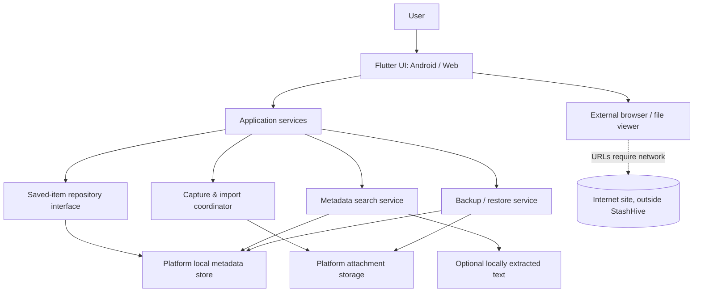

# StashHive — Proposed Architecture

**Status:** Draft architecture for approval; storage choice remains provisional until a proof of concept passes.  
**Date checked for technical references:** 2026-10-21

## Recommendation in plain language

Use one Flutter codebase for the proposed Android-first app and a companion web app, with a small domain layer and platform-specific storage/import adapters. Keep the core local-first: no account server, hosted database, or paid AI API. Store metadata locally and keep imported attachments under a managed local storage strategy. Add a versioned export/restore path before release.

Flutter's official web documentation describes browser support for app-style experiences; its FAQ also explains that the browser does not expose the native file system through `dart:io`, so platform I/O must be separated. See `docs/research/official-sources.md`.

## Context diagram

## Logical components

- **Presentation:** library, search, save/edit, item detail, collections, backup/privacy settings; accessible responsive components.
- **Application/domain:** `SavedItem`, `Tag`, `Collection`, item validation, filter/search behavior, duplicate review, and delete semantics. No Flutter file-system calls inside domain logic.
- **Repository interface:** CRUD, queries, sorting, tags/collections, transaction boundaries, and migration version.
- **Metadata persistence adapter:** a local store selected after Android + web proof of concept. `hive_ce` is the leading candidate because its package documentation says browser boxes use IndexedDB and other platforms use files; its indexing/search suitability must be measured. Isar Community and SQLite alternatives are noted below.
- **Attachment storage adapter:** Android app-specific private directory for app-managed copies; web browser storage/IndexedDB or a user-selected file reference according to validated behavior. Do not store temporary cache data as the only copy of an attachment. Explain uninstall/browser-clear consequences.
- **Capture/import adapter:** manual form, Android system share target, file picker, and web file selection. Android share support must be based on documented intent MIME types and tested against real source apps.
- **Search service:** first search locally stored metadata. Add an extracted-text field/index only for file types/languages whose extraction is validated and available offline. Avoid remote search services.
- **Backup/restore service:** versioned manifest + metadata + copied attachments; validate archive paths, sizes, schema version, file hashes, and conflicts before committing imported state. Export via user-selected destination/download.
- **External links:** open in system browser. Optional title/favicons/page metadata may be fetched only after a later scope decision, using clear UI and safe network boundaries.

## Data model (draft)

### SavedItem

| Field | Type / rule | Notes |
|---|---|---|
| `id` | Stable opaque ID | Never use URL or title as primary key. |
| `type` | link / image / text / document | Video/social URLs remain `link` with a source subtype until true media importing is implemented. |
| `title` | Optional user-editable string | Searchable; generated fallback should be clearly editable. |
| `url` | Optional normalized URL | Only for a link/source URL; validate schemes. |
| `text` | Optional note/snippet | User-provided text; local search source. |
| `attachmentKey` | Optional storage key | Not an absolute machine-specific path. |
| `mimeType`, `byteSize` | Optional metadata | For supported attachments; validate MIME and size. |
| `sourceKind` | manual / share / file-picker | Helps explain where item came from; do not over-collect. |
| `savedAt`, `updatedAt` | UTC instants stored consistently | Render using local locale/time zone. |
| `tags` | List of tag IDs | Prefer normalized tags if relation semantics grow. |
| `collectionId` | Optional stable ID | At most one collection for MVP unless user need changes. |
| `isFavorite` | Boolean | Default false. |
| `extractedText` | Optional derived text | Only after local extractor succeeds; can be cleared/rebuilt. |
| `extractionStatus` | notRequested / available / unsupported / failed | Never treat failure as empty successful extraction. |
| `contentHash` | Optional checksum | For integrity/duplicate suggestion, not tracking. |
| `schemaVersion` | Backup-level initially | Plan DB migration separately if needed. |

### Tag and Collection

`Tag`: stable ID, name, normalized search key, created/updated times. Avoid duplicate tag names under documented case/Unicode rules. `Collection`: stable ID, name, optional description/emoji, created/updated times. Deleting a collection must leave its items in the library and clear their collection assignment after confirmation.

## Capture and storage flows

### Save a link

1. User pastes a URL or shares it from another app.
2. Validate scheme, preserve the original URL for display, optionally normalize only for duplicate checking.
3. Ask the user to confirm/edit title, notes, tags, and collection as applicable.
4. Store local metadata; no webpage is downloaded by default.
5. If the user later opens it, launch the external browser. Network errors belong to the external browser or are explained clearly.

### Save an image/document

1. User selects a file or shares it to the app.
2. Validate supported type and size; copy bytes into managed storage when the feature is designed to own the copy.
3. Write metadata and attachment reference as one recoverable operation; clean orphaned temp files on failure.
4. Create a thumbnail only if useful and feasible; treat thumbnail as a cache, never the sole original.
5. Add a backup/export representation and validate restoration.

### Web platform

- All browser data belongs to the current origin/browser profile. Do not imply cross-device sync.
- No unrestricted local file system access; user selection/download flows must use browser capabilities.
- Browser quota and site-data clearing may remove records/attachments. Prominent export/restore and a first-run reminder are required.
- Opening external URLs is online activity; do not fetch page content invisibly in the background.

## Technology candidates — pending proof of concept

| Area | Candidate | Reason | Validation needed |
|---|---|---|---|
| UI/domain | Flutter + Dart | Fits user's existing Flutter projects; supports app-style web deployment. | Reconfirm local SDK and test Android/web build after approval. |
| Metadata store | `hive_ce` candidate | Package docs describe browser IndexedDB persistence and file-backed boxes on other platforms. | CRUD/migrations, structured filtering, 10k-item search, schema evolution, backup export, package health/version. |
| Alternative store | `isar_community` | Potential indexed local queries. | Current package platform declaration and web behavior must be verified before selection. |
| Alternative store | `sqflite` / SQLite | Mature SQL on mobile, but official package page describes Android/iOS/macOS, with web support listed as experimental through a different package. | May force separate web persistence adapter, raising complexity. |
| Attachment selection | Platform picker/share integrations | User-mediated file selection is privacy-friendly. | Android intent intake + Flutter plugin support; browser file selection and persistence. |
| OCR/text extraction | Not selected | Offline processing is preferred, but model size/language quality is a risk. | POC must record accuracy, languages, offline behavior, app size, latency, and memory. |
| Web hosting | Static hosting such as Cloudflare Pages | Avoids an app backend for a Flutter web build. | Verify current build command, output folder, cache/update behavior, and free-plan limits before deploy. |

## Security / privacy boundaries

- All saved content is untrusted input: URLs, file names, MIME types, archive paths, extracted text, and imported manifests.
- Reject unsupported URL schemes; do not auto-open arbitrary commands or local paths.
- On restore, prevent path traversal, oversized files/archives, duplicate IDs, invalid schema versions, and archive bombs; import into staging before changing the current library.
- Do not log titles, user notes, URLs, document names, image OCR, or imported content.
- Never request broad file-storage access if user-mediated picking and app-managed copies satisfy the feature.
- No network transmission of the library in the MVP. Any future sync, analytics, ads, or remote extraction needs a separate threat/privacy review and explicit product decision.

## Key trade-offs

- **Local-first vs sync:** zero ongoing backend cost and strong privacy, but no automatic cross-device sync. User-controlled backup is the bridge.
- **Metadata search vs OCR:** reliable and small initial core vs more findability. OCR waits until accuracy and binary size are evidenced.
- **One Flutter UI vs platform parity:** shared screens/domain code; platform-specific storage/import behavior still needs separate tests.
- **Browser persistence vs managed files:** web can offer useful local saving but cannot promise durable native-file access; backup messaging is critical.

## Architecture status

- `DONE`: proposed component boundaries, main entity model, important trade-offs, privacy boundaries, and initial Flutter/repository/backup/share source implementation.
- `IN PROGRESS`: validation of Hive CE on Android/web; Android share API behavior on device; browser persistence/backup behavior; backup recovery/checksum regressions; dependency and license review.
- `BLOCKED / DEFERRED`: OCR feasibility and text-extraction implementation until a separate offline feasibility study is approved.
- `NOT STARTED`: final release/deployment decisions, opt-in user testing, and store-readiness checks.

## Phase 1 implementation update — 2026-10-21

Implemented source currently uses three Hive CE boxes: saved item records, attachment bytes, and settings/collection metadata. All UI accesses storage through `LibraryRepository`. Browser/Android behavior is not yet validated by a local SDK run; use CI and real platform tests before locking this choice. Backup format v1 is JSON with a manifest, version, items, collections and base64 attachment entries; the application limits each attachment to 15 MB and combined backup attachments to 100 MB.

## Phase 1 implementation status — 2026-10-21

The first code slice uses three Hive CE boxes via `LibraryRepository`: saved-item records, attachment bytes, and preferences/collections. UI widgets depend on the repository rather than opening boxes directly. This is a provisional persistence choice; Flutter CI and Android/web manual tests must pass before it is considered validated. Backup version 1 is JSON with items, collections, versioned manifest metadata and base64 attachments, capped at 15 MB per attachment and 100 MB combined attachment bytes.

## Phase 2 implementation note — share-event fingerprinting (2026-10-22)

The incoming-share deduplicator serializes each ordered batch's type, path and MIME type, then uses the SHA-256 digest as its short-lived cache key. The cache is bounded by entry count and stores digest strings rather than shared text or paths. The direct dependency is `crypto: ^3.0.7`; package resolution and browser/Android build compatibility remain unverified until the owner requests the manual validation run.

## Phase 2/3 implementation status — 2026-10-22

Core source now includes sequential incoming-share review, bounded/collision-resistant share-event fingerprints, backup/restore validation and rollback coverage, per-attachment SHA-256 integrity checks, text-scale-aware card sizing, theme-aware muted-text contrast, and accessible search/favorite/action semantics. These are source-level changes with regression tests authored; no claim is made that the tests, web/Android builds, Android chooser behavior, browser restart persistence, or screen-reader checks have passed. The manual validation workflow remains disabled for automatic push triggers by owner request.
