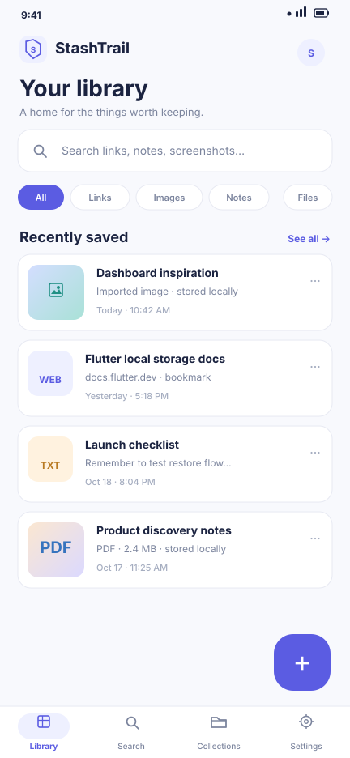
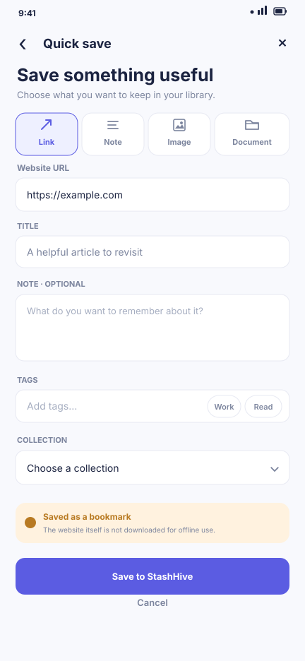
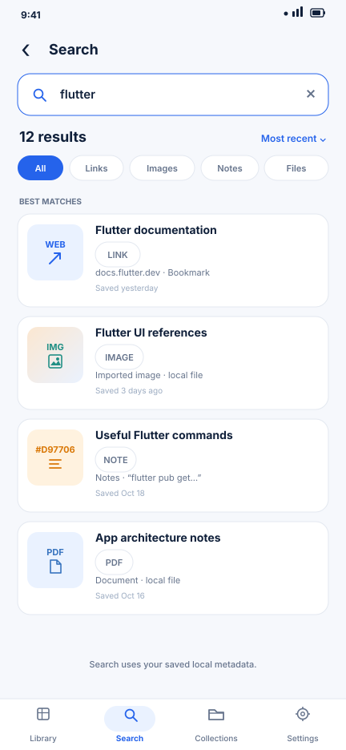
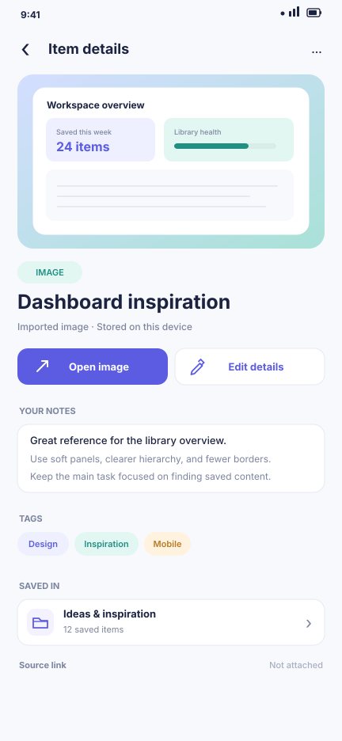
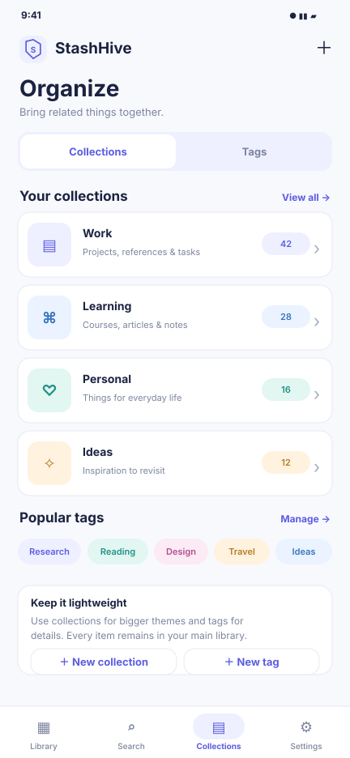
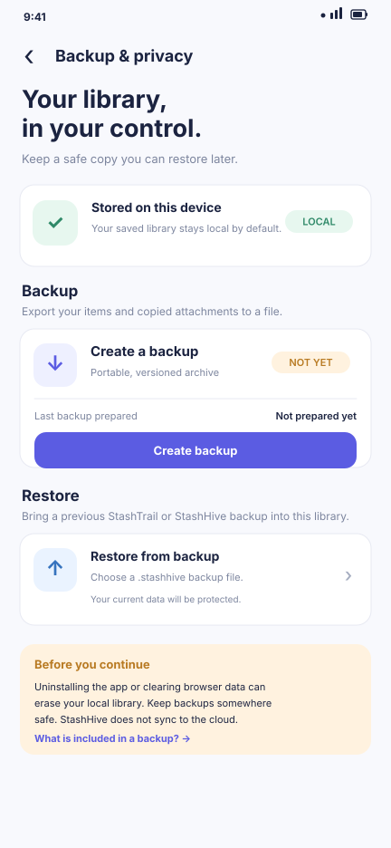
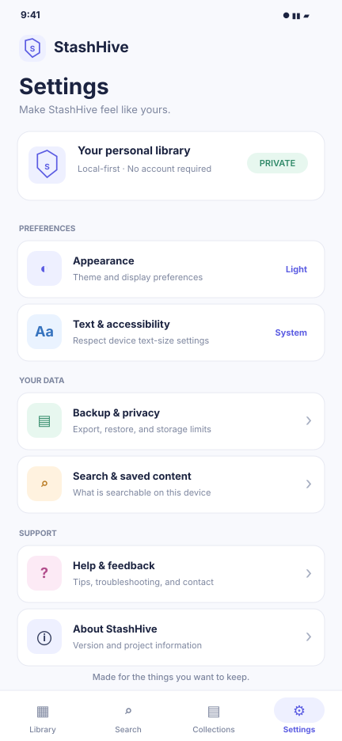

# StashHive — Premium Screen Reference

**Status:** Seven static high-fidelity UI mockups; proposed visual source of truth for implementation. These are not screenshots from a running app.

> Implementation rule: follow these screens as the baseline for layout, hierarchy, labels, navigation and storage-state clarity. Adapt only for approved requirements, accessibility or real platform constraints; record material deviations.

## Shared visual rules

- Warm neutral background, white surfaces, deep navy text, indigo actions and restrained teal/amber/blue type accents.
- Reusable spacing of 4 / 8 / 12 / 16 / 24 / 32; 12–16 radius for cards; consistent typography.
- Search-first retrieval. Do not let decoration overwhelm saved content.
- Local-first MVP: no required login, cloud sync or paid AI API.
- A bookmark is not an offline webpage. A copied file is not the same as preview metadata.
- Implement empty, loading, error, permission-denied, unsupported-file and large-text states in addition to the happy path.

## SCR-001 — Library

Purpose: make search immediately available and show recently saved items in one typed library.

Visible hierarchy: StashHive header; global search; All / Links / Images / Notes / Files filters; recently saved cards with type, title, source/storage state and saved time; add action; primary navigation.

Interactions: search opens Search Results; result opens Item Details; add opens Quick Save; filters update the list; “See all” opens the full library.

Required states: first-run empty library; loading and recoverable storage error; no results; long-title wrapping; discoverable favorites/sort.

Traceability: FR-004, FR-005.

## SCR-002 — Quick Save / Add Item

Purpose: focused capture for a link, note, image or document. The screen must not imply a URL is downloaded for offline use.

Visible hierarchy: back/cancel; content-type selector; type-specific fields; tags and collection; primary Save action; bookmark-not-offline explanation for links.

Interactions: type selection changes the input fields; validate required values and URL schemes; successful save persists locally and confirms.

Required states: validation that retains input; picker cancellation with no ghost item; unsupported/oversized file errors; share-intent review when supported.

Traceability: FR-001, FR-002, FR-006–009.

## SCR-003 — Search Results

Purpose: search local titles, URLs, notes and tags across mixed content types.

Visible hierarchy: retained query and clear action; result count and sort; type chips; labeled result cards; local-metadata search cue.

Interactions: typing updates results; filters narrow results; clearing resets the query; tapping a result opens Item Details.

Required states: no results with clear/refine options; loading/error with retry; Unicode-safe user-entered text; no false claim of OCR search when extraction is unavailable.

Traceability: FR-004–005, FR-016.

## SCR-004 — Item Details

Purpose: canonical detail view for item content, metadata, and real storage state.

Visible hierarchy: back/share/more; type-appropriate preview; title and saved time; source URL or file info; notes, tags and collection; Open/Edit/Favorite actions.

Interactions: URLs open externally and may need network; files open in a supported viewer; edit/favorite/collection/delete update the same item.

Required states: missing attachment, unsupported viewer, broken URL, delete confirmation, honest extraction-unavailable state.

Traceability: FR-003, FR-006, FR-011, FR-017.

## SCR-005 — Collections & Tags

Purpose: keep organization lightweight—collections are larger themes, tags add cross-cutting labels.

Visible hierarchy: Collections/Tags selector; collection rows with counts; create/manage actions; tag chips; helpful empty states.

Interactions: open a collection to browse; create/rename/delete with confirmation; add/remove tags with duplicate-name validation.

Required states: empty collection; duplicate tag; deleting a collection unassigns items but never deletes them; long names/counts wrap.

Traceability: FR-010.

## SCR-006 — Backup & Privacy

Purpose: explain local data ownership and offer portable export/restore without suggesting cloud synchronization.

Visible hierarchy: local-storage status; create backup and last-export state; restore from selected archive; what is included; data-loss warning; no-account/no-cloud-sync privacy statement.

Interactions: export a versioned archive; validate restore before changing live data; conflicts are explicit; invalid backups fail safely.

Required states: progress/cancel/failure/insufficient storage; corrupt or unknown-version backup; conflict review; restore counts; browser quota/file-picker behavior.

Traceability: FR-012–015, FR-018.

## SCR-007 — Settings

Purpose: expose real preferences and data-management controls without invented account, notification or sync switches.

Visible hierarchy: appearance; system text sizing; backup/privacy; search help; help/feedback; About; local-first status cue.

Interactions: appearance updates shared tokens; Backup & Privacy opens SCR-006; About reads the actual app version at runtime.

Required states: unavailable platform controls are hidden or explained; large text wraps; keyboard focus/semantics work on web; settings match real platform capability.

Traceability: FR-018, NFR-002–006.

## Implementation guardrails

1. Do not invent login, cloud sync, subscriptions, notifications, AI summaries, OCR guarantees or offline-web capture outside the approved scope.
2. Clearly distinguish URL bookmarks, copied local files, metadata previews and offline snapshots.
3. Preserve screen IDs; update `docs/traceability-matrix.md` with implementation locations and tests.
4. Storage and OCR dependencies remain decisions for feasibility testing.
5. These mockups guide the UI but do not constitute a production build or deployment approval.

## Phase 3 refinement — responsive saved-item titles

Library item cards now allow titles to wrap to two lines before truncating, improving retrieval of long saved titles on narrow screens. Manually verify 320–360 px mobile widths, large system text and desktop layouts against SCR-001. This is a source-level adjustment, not a visual test result.

## Phase 3 refinement — large text and saved-item cards

Library and Search card heights now adapt to the active text scaler so two-line titles and the metadata row have more vertical room at larger system text sizes. This is a responsive safeguard, not a claim that every screen-reader or large-text layout has passed verification.

## Phase 3 refinement — screen-reader labels

Saved image previews now have title-based semantic labels, and the visible favorite star communicates that an item is saved as a favorite. Verify the resulting semantics on Android TalkBack and at least one desktop/web screen reader; source changes alone do not establish accessibility compliance.

## Phase 3 refinement — accessible Library search

The Library search teaser acts as a navigation button; it is not itself an editable search field. The implementation now exposes that distinction in its semantics while preserving the visual treatment from SCR-001. The real Search screen remains the place for text entry.
