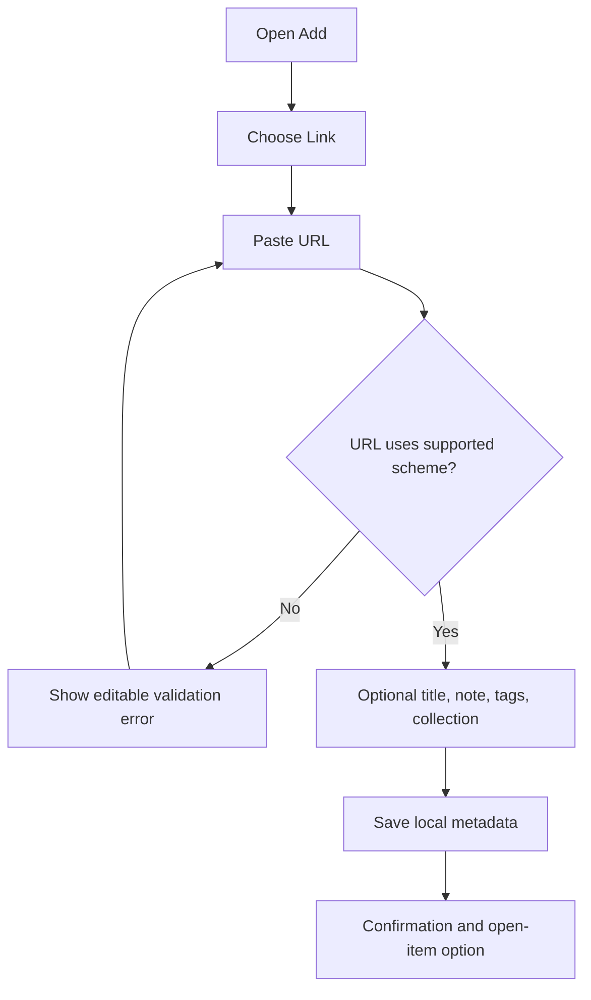
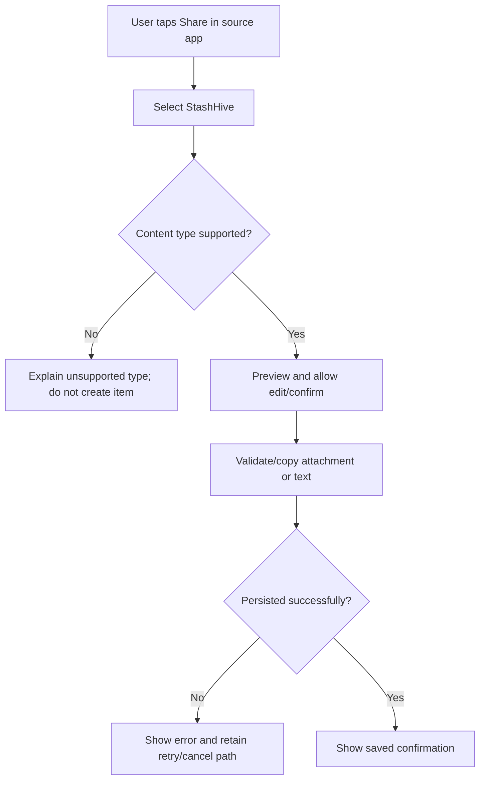
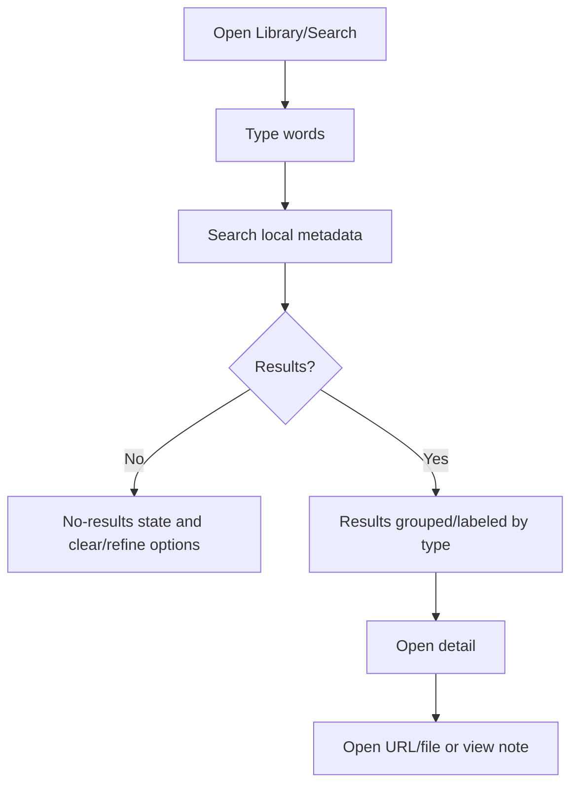

# StashHive — User Flows

**Status:** Proposed flows; to validate in prototype.

## FL-001 — Save a link manually

## FL-002 — Share content from Android

This flow is contingent on a working Android intent/share proof of concept and supported MIME types. No equivalent universal web share-receiver behavior is assumed.

## FL-003 — Search and retrieve

## FL-004 — Export backup

1. Open Backup & Privacy.
2. Review what the archive will include.
3. Start export; show progress and allow safe cancellation if supported.
4. Validate manifest and attachment counts; write/download through platform-appropriate flow.
5. Show where the backup was saved or how the browser downloaded it. Do not log its content.

## FL-005 — Restore backup

1. User selects a backup file.
2. Inspect the archive safely in a temporary staging area.
3. Validate schema version, file count/size, IDs, relative paths and optional hashes.
4. Explain conflicts and choose an explicit merge/replace behavior—never silently erase the current library.
5. Import in a recoverable operation; report restored/skipped/error counts.

## FL-006 — Delete item

- User taps Delete on detail.
- Dialog explains whether the StashHive-managed copy will be removed and whether a user-owned original will remain.
- Cancel leaves the item intact. Confirm removes record and owned attachment according to the defined lifecycle rule; show undo where technically reliable.
